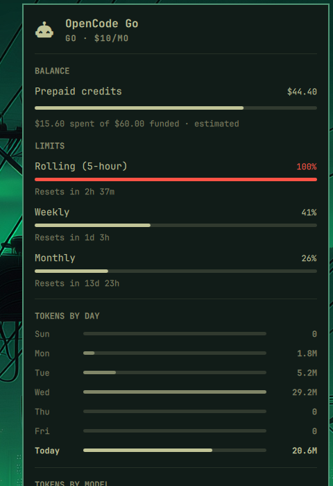
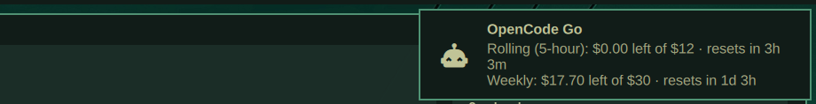

# OpenCode Go für Omarchy

Ein Omarchy-Shell-Plugin, das dein **OpenCode-Go-Plan-Kontingent** in die obere
Leiste bringt: Rest-Dollar, Reset-Countdowns, Gleichmäßigkeits-Benchmarks,
Budget-Alarme und Verhaltensempfehlungen – plus Token-Historie nach Tag und
Modell.




## Funktionen

- **Quota-Tab** im Agents-Panel: Monats-Balance in Dollar (von $60), drei
  Limit-Balken – Rolling 5 h ($12), Weekly ($30), Monthly ($60) – je mit
  live Reset-Countdown, plus lokale Token-Stats (heute, 7 Tage, nach Modell).
- **Zweifarbiger Bar-Icon-Alarm**: teal, wenn ein Abrechnungsfenster aufs
  Reset zuläuft, obwohl noch viel Budget verfallen würde (warnt ab 60 % Rest
  bei halber Zeit, bis 20 % Rest in den letzten 24 h) – Zeit für die teuren
  Modelle; rot, wenn ein Fenster fast erschöpft ist (≥90 %) oder das
  Guthaben zur Neige geht. Creme bedeutet Ruhe.
- **Stale-Warnung**: Ist der Record älter als 30 Minuten (z. B. Timer
  steht), sagt das Panel das, statt still alte Zahlen zu zeigen.
- **Even-Pace-Ticks** auf jedem Limit-Balken: wo der Verbrauch bei perfekt
  gleichmäßiger Nutzung stünde.
- **Abgestufte Balkenfarben** aus deinem Theme gemischt (60/80/90).
- **Situations-Tags** pro Fenster (`ERSCHÖPFT` / `KNAPP` / `ZU SCHNELL` /
  `NUTZEN`).
- **EMPFEHLUNG-Sektion**: bis zu zwei Verhaltenszeilen (z. B. „Rolling
  erschöpft — Reset in 2h 37m. Bis dahin günstig prompten.").
- **Limit-Zeilen mit Rest-Dollar**: jedes Fenster liest sich als
  „26 % · $44.40 übrig“ – keine Kopfrechen-Math mehr. (Verlauf wird
  weiter für künftige Charts gesammelt.)
- **48-h-Popup**: Desktop-Notification mit allen Zahlen höchstens alle
  48 Stunden; Klick öffnet das Panel.
- **i18n**: Englisch + Deutsch dabei, mehr per Contributor-Locales.
- **Settings** ohne Datei-Edit: Sprache, Popup an/aus + Intervall, Alarm
  an/aus, Farbabstufung an/aus.

## Voraussetzungen

- Omarchy 4.x mit Shell (`omarchy-shell`)
- opencode mit aktivem **Go-Plan** (der Key aus
  `~/.local/share/opencode/auth.json` wird wiederverwendet – nur gelesen,
  nie ausgegeben)

## Installation

Empfohlen – direkt aus Git (Updates via `omarchy plugin update`):

```bash
omarchy plugin add https://github.com/AndiWandHerd/omarchy-opencode-go.git --enable --yes
./install.sh --yes   # aus dem geklonten Repo: Collector + systemd-Timer
```

Manuell:

```bash
git clone https://github.com/AndiWandHerd/omarchy-opencode-go.git
cd omarchy-opencode-go
./install.sh
```

Der Installer validiert das Plugin, installiert Collector plus 5-Minuten-
Timer, platziert das Widget oben rechts und bietet an, das Stock-Panel
`omarchy.agents` zu deaktivieren (gleiche Provider, weniger Features –
beide zusammen zeigen ein doppeltes Icon). Falls QML-Änderungen je nicht
auftauchen: `omarchy restart shell`.

## Konfiguration

Alles liegt im Bar-Eintrag des Widgets (`~/.config/omarchy/shell.json`):

```bash
omarchy bar set opencode-go language de
omarchy bar set opencode-go popupIntervalHours 24 --json
omarchy bar set opencode-go popupEnabled Off
omarchy bar set opencode-go leftoverAlarm Off
omarchy bar set opencode-go graduatedColors Off
```

| Schlüssel | Standard | Wirkung |
|---|---|---|
| `language` | `"auto"` | Panel- + Notification-Sprache (`auto` folgt der System-Locale; `en`, `de`) |
| `popupEnabled` | `"On"` | 48-h-Quota-Notification an/aus |
| `popupIntervalHours` | `48` | Mindeststunden zwischen Popups |
| `leftoverAlarm` | `"On"` | Bar-Icon-Alarm für verfallendes Budget an/aus |
| `graduatedColors` | `"On"` | Warme Balkenfarben an/aus |

Der Collector liest denselben Eintrag – es gibt genau eine Stelle zum
Konfigurieren. API-Keys stehen hier nie – Auth bleibt in opencodes
`auth.json`.

Optionale Umgebung für den Collector (alles standardmäßig unset):

| Variable | Wirkung |
|---|---|
| `OPENCODE_GO_API_KEY` | Key-Override (erste Wahl, vor `auth.json`) |
| `OPENCODE_API_KEY` | Letzter Fallback, wenn sonst kein Key gefunden wurde |
| `OPENCODE_API_BASE_URL` | Mirror/Proxy-Basis statt `https://opencode.ai` — muss `https://` sein, sonst verweigert der Collector den Key-Versand |
| `OPENCODE_DB` / `OPENCODE_DATABASE` | Expliziter Datenbankpfad statt Auto-Auflösung |

## Funktionsweise

Alle 5 Minuten läuft per systemd-User-Timer der Collector
(`collectors/omarchy-agent-usage-opencode-go`): fragt den offiziellen
Go-Usage-Endpunkt (`GET https://opencode.ai/zen/go/v1/usage`) mit deinem
Key, rechnet Rest-Dollar aus den Prozenten, scannt read-only deine
`opencode.db` für Token-Stats und schreibt einen JSON-Record nach
`~/.local/state/omarchy/agents/usage/opencode-go.json`. Das Panel beobachtet
das Verzeichnis und rendert, was erscheint – derselbe Erweiterungspunkt, den
das Stock-Panel dokumentiert. Verlauf wird nebenbei für künftige Charts
gesammelt (`opencode-go-history.jsonl`).

Der Datenbank-Scan ist inkrementell: Nach einem Volldurchlauf werden nur
noch Rows nahe der Scan-Watermarke neu gelesen (10-Minuten-Überlappung,
In-Place-Token-Finalisierung wird korrigiert statt doppelt gezählt); die
Datenbank wird automatisch aufgelöst (expliziter Pfad → frischeste
`opencode-*.db` nach WAL-Aktivität → `opencode.db`). Caches sind owner-only
(0600). HTTP-429-Antworten setzen einen Retry-Hinweis statt zu scheitern.

## Maschinen-Interface

Andere Tools können dieselben Daten nutzen, die das Panel rendert — eine
Tagesroutine, die prüft, ob Budget ausgegeben werden sollte, ein Cron-Nudge
oder ein Agent-Hook. Drei Nähte, keine Extra-Dependencies:

**1. Record-Datei (empfohlen zum Pollen)** —
`~/.local/state/omarchy/agents/usage/opencode-go.json`, alle 5 Minuten frisch
per systemd-Timer. Ein JSON-Objekt:

- `schemaVersion` (aktuell 1), `id` (`"opencode-go"`), `name`,
  `updatedAt` (ISO-8601 des letzten Collector-Laufs)
- `limits[]`: pro Fenster `{label, title, key ("rolling"|"weekly"|"monthly"),
  percent (0–1 verbrauchter Anteil), limit (USD-Kontingent), resetsAt (ISO)}`
- `balance`: Monats-Dollar `{remaining, funded, spent, currency,
  estimated}` (`estimated`, weil die API ganze Prozente liefert)
- `advice[]`: bis zu zwei `{text, tone}`-Verhaltenszeilen; `tone` ist
  `good` (ausgeben), `bad` (Gefahr) oder `info` (ruhig) — das
  maschinenlesbare „Soll ich ausgeben?"-Signal
- Token-Stats: `todayPrompts/Sessions/TotalTokens/TokensByModel`,
  `recentDays[]` (7× `{date, messageCount}` in Token), `modelUsage{}`,
  `totalPrompts/Sessions`, `activeDays/Dates`
- `ready`, `tierLabel`, `usageStatusText`/`authHelpText` (gesetzt, wenn der
  Quota-Abruf scheiterte; lokale Stats stehen trotzdem)

Stabilitätsversprechen: Felder kommen nur dazu; ein Bruch erhöht
`schemaVersion`. Spenden-Check in einer Zeile:

```bash
tone=$(jq -r '.advice[0].tone // "info"' ~/.local/state/omarchy/agents/usage/opencode-go.json)
[ "$tone" = good ] && jq -r '.advice[0].text' ~/.local/state/omarchy/agents/usage/opencode-go.json
```

**2. Collector-CLI (frische On-Demand-Checks)** —
`omarchy-agent-usage-opencode-go [--force] [--limits-only]` druckt exakt
eine JSON-Zeile (gleiches Schema) nach stdout, sonst nichts. Exit-Code ist
immer 0 (Fehler stehen in `usageStatusText`); validieren mit `jq -e .`.

**3. History (Zeitreihe)** —
`~/.local/state/omarchy/agents/opencode-go-history.jsonl`, eine Zeile pro
frischem Probe: `{"t": ms-Epoche, "rolling": %, "weekly": %, "monthly": %,
"resets": {...}}` (Prozente 0–100 verbraucht). Für Charts und Pace-Math.

**4. Panel-IPC (Steuerung, keine Daten)** —
`omarchy-shell opencode-go <open|close|toggle|refresh|next>` steuert das
Panel, z. B. als `--exec`-Ziel für Notification-Klicks.

## Sprachen

Englisch und Deutsch liegen in `locales/` bei. Eigene Sprache gefällig:
`locales/en.json` kopieren, Werte übersetzen (`{Platzhalter}` behalten) und
PR aufmachen – siehe [CONTRIBUTING](CONTRIBUTING.md).

## Deinstallation

```bash
./uninstall.sh            # behält Verlauf/State
./uninstall.sh --purge    # entfernt auch Verlauf/State/Caches
```

## Upstream-Hinweise

Der Quota-Collector folgt dem Stock-`omarchy-agent-usage-*`-Vertrag, der
Go-Tab rendert also auch auf dem *Stock*-Panel (ohne Deluxe-Extras). Ob
Upstream den Collector in-tree will, steht in
[docs/upstream-discussion-draft.md](docs/upstream-discussion-draft.md).

## Verwandte Projekte

- [akitaonrails/ai-usagebar](https://github.com/akitaonrails/ai-usagebar) —
  das Schwergewicht: Rust-Binary plus Waybar-/TUI-/Tray-Frontends für 16
  KI-Provider (inklusive OpenCode Go) mit Schwellen-Notifications. Wer
  Multi-Provider-Quota in mehreren Desktop-Umgebungen braucht, fängt dort an.
  Dieses Plugin geht stattdessen in die Tiefe eines Plans: Rest-Dollar,
  Verfalls-Alarme und Verhaltensempfehlungen speziell für OpenCode Go.
- [markbus-ai/omarchy-opencode-usage](https://github.com/markbus-ai/omarchy-opencode-usage) —
  das Schwester-Widget für OpenCode-Nutzung in der Omarchy-Bar (Token-Stats
  plus Go-Plan-Meter). Sein inkrementeller Watermark-Scan war Vorbild für
  unseren v0.2.0-Scan-Core.
- [FidelVillaRod/opencode-omarchy-plugin](https://github.com/FidelVillaRod/opencode-omarchy-plugin) —
  komplementär statt konkurrierend: Session-Verwaltung (Resume/Export/Delete,
  Model-Picker), wo dieses Plugin Quota-Tiefe bietet. Beide laufen
  konfliktfrei nebeneinander.

## Lizenz

MIT – siehe [LICENSE](LICENSE).
